# La luz que no llega a la red: el mercado solar que crece en las sombras de La Habana

**Sumario:** Mientras la electricidad disponible en Cuba cayó un 13,4 % entre 2019 y 2022, los habaneros han construido un mercado paralelo de paneles solares en canales de Telegram y Revolico. Una investigación con 382 anuncios y 35 entrevistas revela un mercado opaco, con precios que varían un 27 % entre lo que se pide y lo que se paga, y una marca que domina los anuncios pero no las compras.

## Lead

Cada noche, cuando la red eléctrica se apaga, La Habana se oscurece. Pero en esa oscuridad crece algo: un mercado de paneles solares que nadie registra oficialmente. Lo que empezó como respuesta a los apagones se ha convertido en un fenómeno económico con reglas propias, precios opacos y marcas que se anuncian pero no se compran.

## El contexto: la red que se contrajo

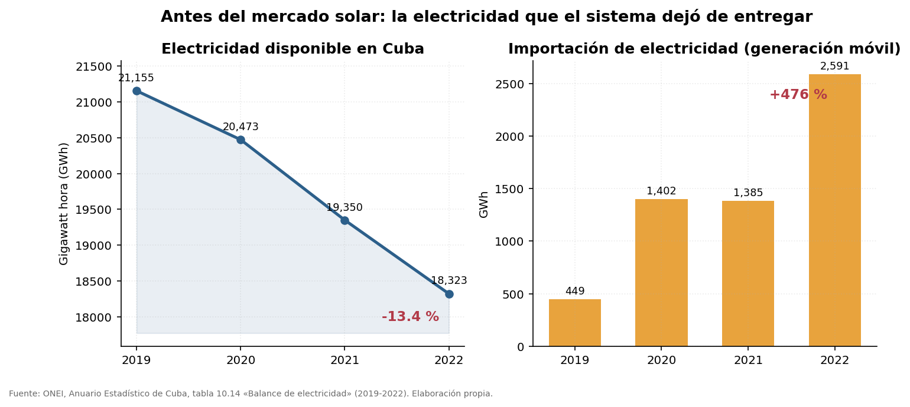

La ONEI registra una caída del 13,4 % en la electricidad disponible entre 2019 y 2022 (21 155 → 18 323 GWh), mientras la importación de generación móvil se disparó un 476 %.

*Fuente: ONEI, tabla 10.14.*

## Un mercado que se anuncia por temporadas

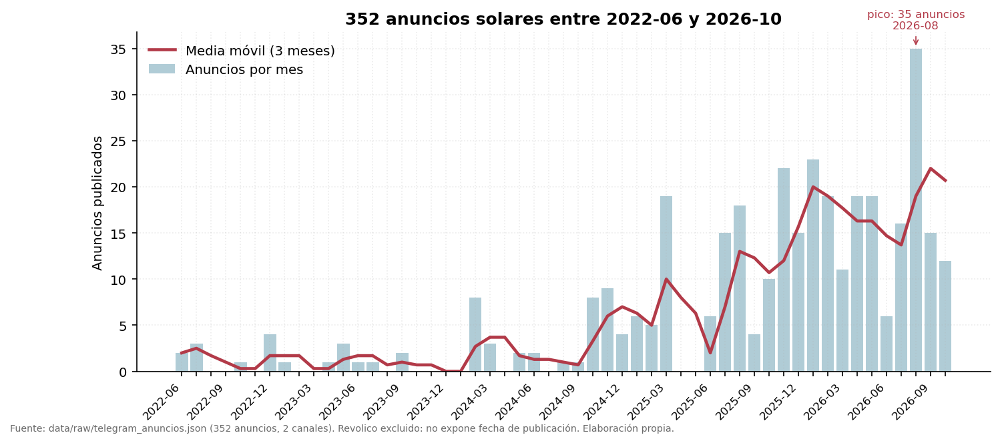

Los anuncios en Telegram crecen por oleadas. No hay temporada baja.

*Fuente: 352 anuncios de Telegram (2022-06 a 2026-10).*

## Paneles sueltos vs. sistemas completos

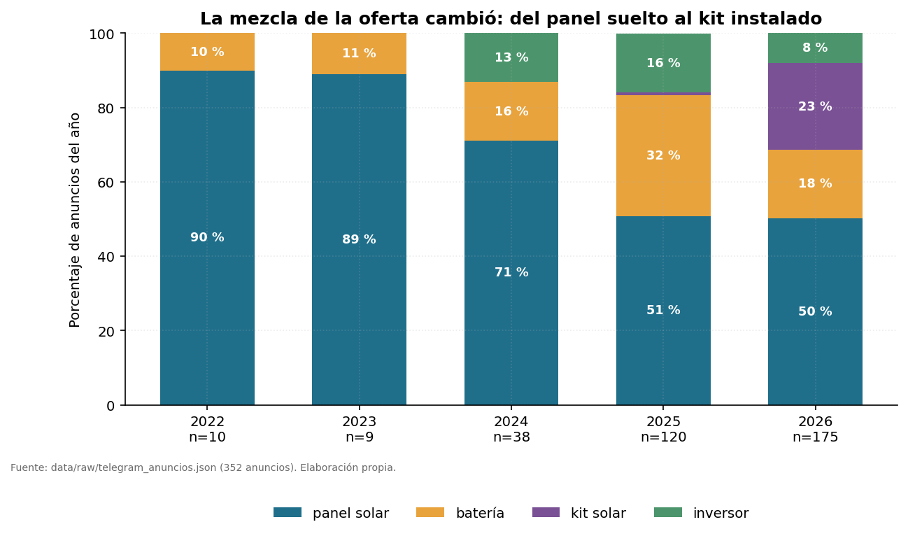

El mercado se divide entre paneles sueltos y kits completos.

*Fuente: anuncios de Telegram y Revolico (n=382).*

## La opacidad: el precio que no se dice

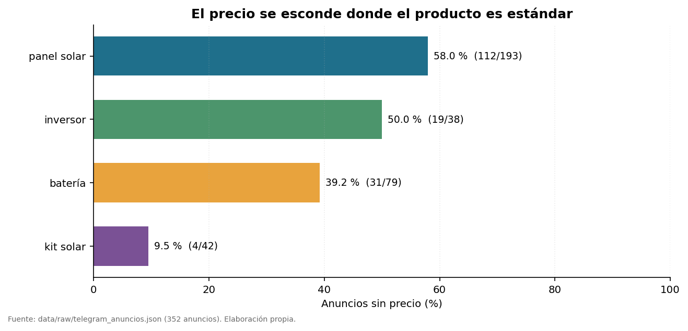

Más de la mitad de los anuncios de panel solar (58,0 %, 112 de 193) omite el precio, frente al 9,5 % de los kits (4 de 42).

*Fuente: anuncios limpios (n=382).*

## ¿Cuánto cuesta realmente un watt?

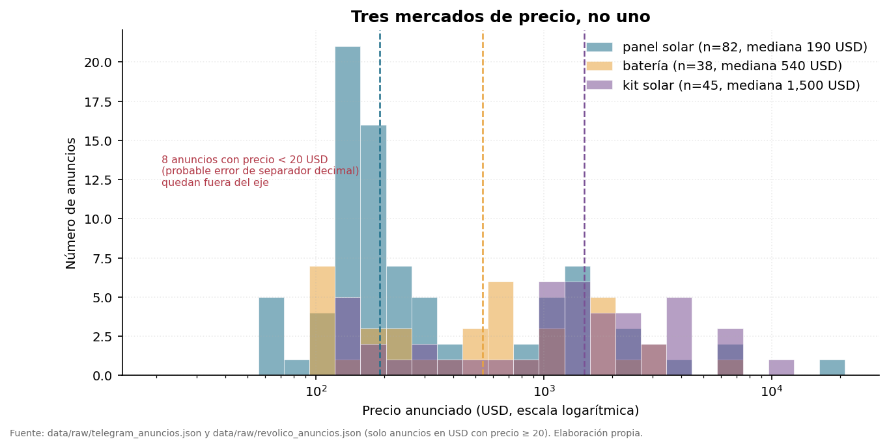

La mediana anunciada es de 0,364 USD/W (n=71).

*Fuente: anuncios con precio en USD (n=71).*

## La economía unitaria del panel

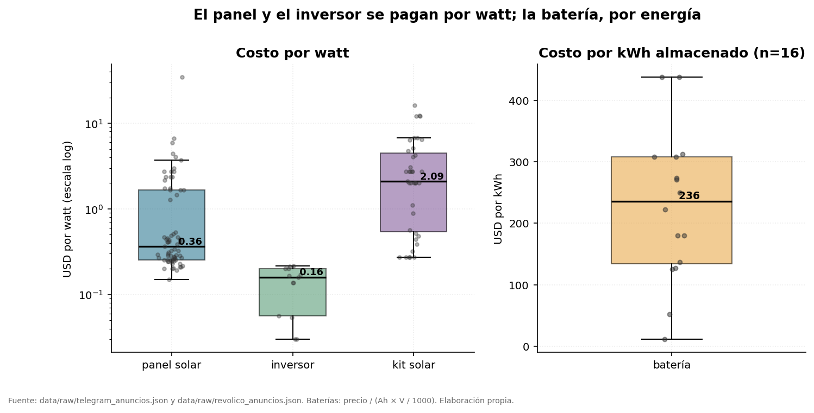

El costo por watt es solo parte de la historia.

*Fuente: anuncios limpios.*

## Potencia vs. precio

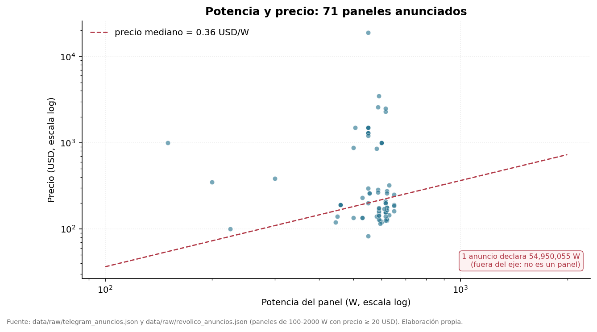

No existe una correlación clara entre potencia y precio por watt.

*Fuente: anuncios con potencia y precio (n=71).*

## La brecha entre lo que se pide y lo que se paga

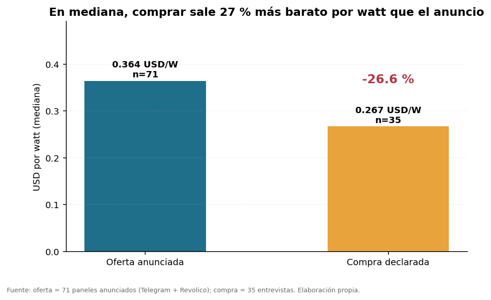

Los compradores pagan una mediana de 0,267 USD/W (n=35), un 27 % menos que el precio mediano anunciado (0,364 USD/W).

*Fuente: anuncios (n=71) y entrevistas (n=35).*

## Canales: Telegram domina, Revolico resiste

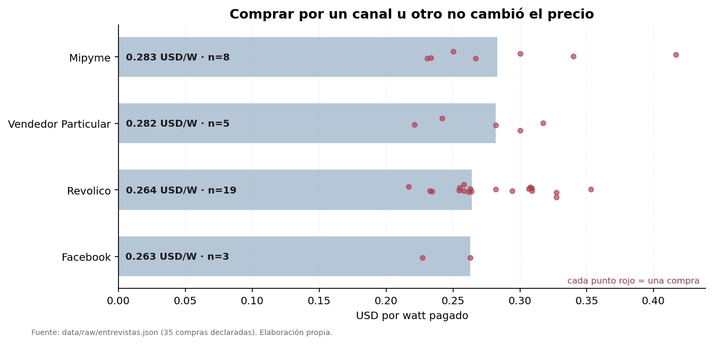

Telegram concentra la mayor parte de la oferta, pero Revolico mantiene una presencia residual.

*Fuente: anuncios limpios (n=382).*

## La garantía: una promesa de palabra

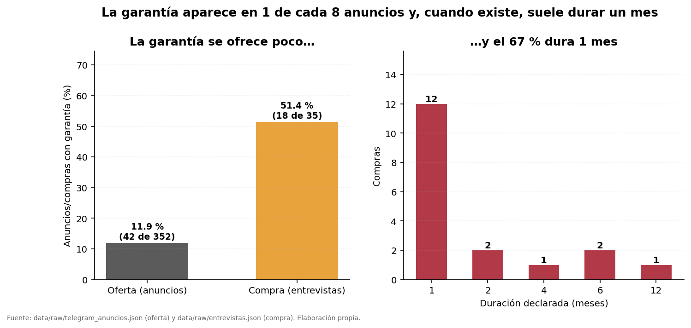

Solo el 11,9 % de los anuncios (42 de 352) menciona garantía. Pero el 51,4 % de los compradores la obtuvo (18 de 35), y 12 de esas garantías eran de solo un mes.

*Fuente: anuncios (n=352) y entrevistas (n=35).*

## MUST: la marca que más se anuncia y nadie compra

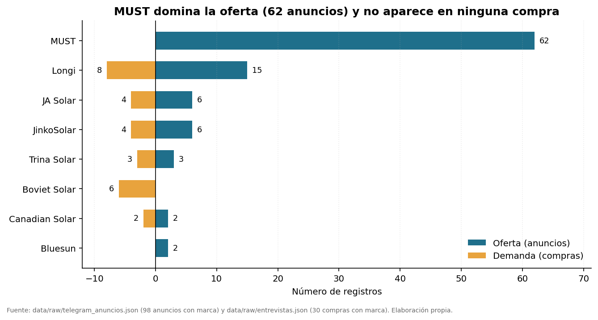

MUST lidera la oferta (62 de 98 anuncios con marca, 63 %) pero aparece en **0 de 35** compras.

*Fuente: anuncios (n=98 con marca) y entrevistas (n=35).*

## El solar se compra como sistema

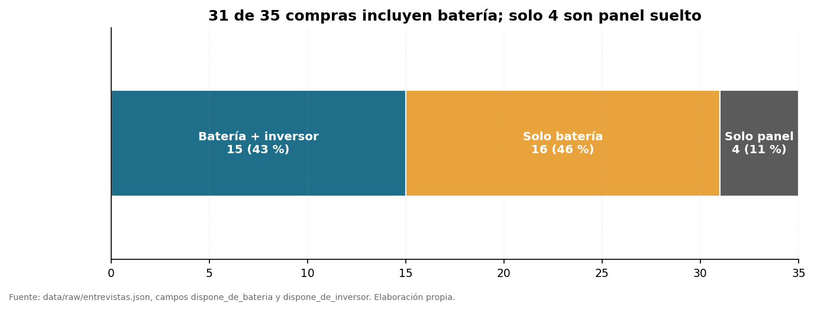

El 89 % de las compras (31 de 35) incluye batería y el 43 % (15 de 35) inversor.

*Fuente: entrevistas (n=35).*

## Cierre

Los habaneros han construido, con paciencia y reglas propias, un mercado que el Estado no registra. Pero sin datos oficiales, sin series de cambio y sin geografía, el análisis se detiene donde empieza la opacidad.

## Nota metodológica

Investigación basada en 382 anuncios (352 de Telegram con fecha, 30 de Revolico sin fecha) y 35 entrevistas a compradores (sin fecha de compra), más la serie oficial de la ONEI (2019-2022) y datos abiertos del Banco Mundial (solo contexto). Reglas: no se imputa nada (NaN), no se convierten monedas (9 anuncios en EUR/CUP excluidos), errores marcados no borrados, archivos sintéticos descartados. Limitaciones: n=35 en demanda (descriptivo, no inferencial), 94,9 % sin municipio, precios declarados no facturados, ONEI hasta 2022.